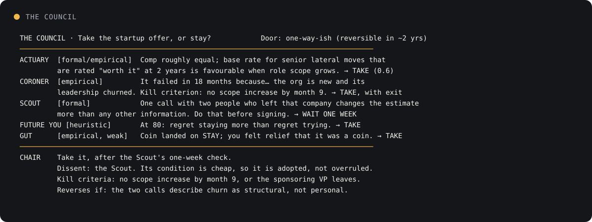

<p align="center"></p>

# Panta Rhei Decide

A decision-making skill for Claude, Claude Code and Hermes: a council of frameworks that weighs the numbers and the human factors.

<p align="center">
  <a href="#install"></a>
  
  
  
</p>

## What it does

Hard choices get either a pros-and-cons list or a confident verdict. Panta Rhei Decide seats a council of advisors, each speaking for a decision method (expected value, pre-mortem, regret, the gut check), and a Chair who reconciles them and records the dissent. You get the decision, the kill criteria that would reverse it and a journal entry to check it against later.

## Try it

Say any of these after installing:

> Should I take the startup offer or stay at my current job?
> We have three vendors left. Help us pick one.
> Should we launch in March or wait for the full feature set?

## How it works: The Council

The number of advisors depends on whether the choice can be reversed. The Actuary always sits; at least one advisor speaks for feelings and values. Each gives a verdict with its evidence class, and the Chair decides.

<p align="center"></p>

```
THE COUNCIL · Take the startup offer, or stay?            Door: one-way-ish (reversible in ~2 yrs)
─────────────────────────────────────────────────────────────────────────────────────
ACTUARY  [formal/empirical]  Comp roughly equal; base rate for senior lateral moves that
         are rated "worth it" at 2 years is favourable when role scope grows. → TAKE (0.6)
CORONER  [empirical]         It failed in 18 months because… the org is new and its
         leadership churned. Kill criterion: no scope increase by month 9. → TAKE, with exit
SCOUT    [formal]            One call with two people who left that company changes the estimate
         more than any other information. Do that before signing. → WAIT ONE WEEK
FUTURE YOU [heuristic]       At 80: regret staying more than regret trying. → TAKE
GUT      [empirical, weak]   Coin landed on STAY; you felt relief that it was a coin. → TAKE
─────────────────────────────────────────────────────────────────────────────────────
CHAIR    Take it, after the Scout's one-week check.
         Dissent: the Scout. Its condition is cheap, so it is adopted, not overruled.
         Kill criteria: no scope increase by month 9, or the sponsoring VP leaves.
         Reverses if: the two calls describe churn as structural, not personal.
```

1. **Set the table:** the options, the door (one-way or two-way) and the time horizon.
2. **Convene the council:** three advisors for reversible choices, five or six for irreversible ones.
3. **The Chair:** the decision, the dissent, the kill criteria and what would reverse it.
4. **Record:** a decision-journal entry, so the outcome can be judged fairly later.

## Install

**Claude Code**
```
/plugin marketplace add fairyanna85/pantarhei-decide
/plugin install pantarhei-decide@pantarhei-decide
```
Or install the whole family: `/plugin marketplace add fairyanna85/pantarhei`.

**Hermes Agent**
```
hermes skills install https://github.com/fairyanna85/pantarhei-decide
```

**Claude apps (web, desktop, mobile)**
1. Download [`pantarhei-decide.zip`](https://github.com/fairyanna85/pantarhei-decide/releases/latest/download/pantarhei-decide.zip).
2. Go to **Customize > Skills**, click **+**, then **+ Create skill**, then **Upload a skill**, and choose the ZIP.
3. Turn the skill on. Code execution and file creation must be enabled (Settings > Capabilities).

**Any Agent Skills client** (Codex, Cursor and others): copy `skills/pantarhei-decide/` into your
client's skills folder.

## What's inside

| Group | Methods |
|---|---|
| **The Actuary** | Expected value · Reference-class forecast · Decision tree · Weighted criteria · Even swaps |
| **The Coroner** | Pre-mortem · Kill criteria |
| **The Scout** | Value of information · Keep options open · Explore or exploit · One-way and two-way doors |
| **The Stoic** | Values alignment · Value-focused thinking |
| **Future You** | Regret minimisation · 10/10/10 · Fear-setting |
| **The Gut** | Coin-flip gut check · Body signal · Recognition-primed decision · Discernment |
| **The Clerk** | Satisfice · Fast and frugal heuristics · Hell yeah or no |
| **Process and record** | Decision quality chain · WRAP · Vanishing options test · Scenario planning · Independent judgments first · Advise a friend · Decision versus outcome · Decision journal |

## How honest is it?

Every method carries an evidence class (`formal`, `empirical`, `heuristic`, `analogical`) and its
origin, and the skill caps its claims by them. Practitioner methods are labelled as such.
Advisors built on empirical findings say so; those built on practitioner or faith traditions are labelled as such, and none of them claims to predict the outcome.

## The Panta Rhei pack (optional)

Each module works on its own. The pack installs all five plus Panta Rhei, the hub that runs them
end to end.

| | Module | For |
|---|---|---|
| 🔵 | [Panta Rhei Reframe](https://github.com/fairyanna85/pantarhei-reframe) | Working out what the real problem is |
| 🟣 | [Panta Rhei Brainstorm](https://github.com/fairyanna85/pantarhei-brainstorm) | Brainstorming and idea generation |
| 🟢 | [Panta Rhei Solve](https://github.com/fairyanna85/pantarhei-solve) | Structuring and diagnosing problems |
| 🔴 | [Panta Rhei Challenge](https://github.com/fairyanna85/pantarhei-challenge) | Red-teaming ideas and claims |
| 🟡 | [Panta Rhei Decide](https://github.com/fairyanna85/pantarhei-decide) | Making the call |
| ⚫ | [Panta Rhei](https://github.com/fairyanna85/pantarhei) | The pack: all five, end to end |

## Credits and license

Methods are credited to their originators in `catalog.json` and on every card; all descriptions are
our own wording. Code: MIT. Method text: CC BY 4.0. Propose a method: see [CONTRIBUTING.md](CONTRIBUTING.md).
