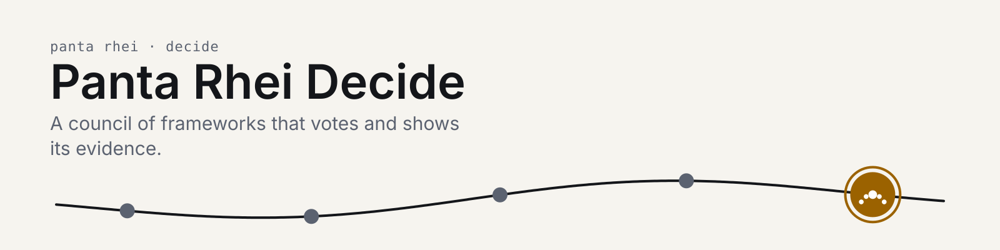
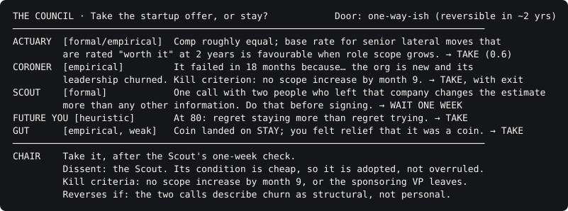

<p align="center"></p>

# Panta Rhei Decide

A decision-making skill for Claude, Claude Code and Hermes: a council of frameworks that weighs the numbers and the human factors.

<p align="center">
  <a href="#install"></a>
  
  
  
</p>

## What it does

Hard choices get either a pros-and-cons list or a confident verdict. Panta Rhei Decide seats a council of advisors, each speaking for a decision method (expected value, pre-mortem, regret, the gut check), and a Chair who reconciles them and records the dissent. You get the decision, the kill criteria that would reverse it and a journal entry to check it against later.

## Try it

Say any of these after installing:

> Should I take the startup offer or stay at my current job?
> We have three vendors left. Help us pick one.
> Should we launch in March or wait for the full feature set?

## How it works: The Council

The number of advisors depends on whether the choice can be reversed. The Actuary always sits; at least one advisor speaks for feelings and values. Each gives a verdict with its evidence class, and the Chair decides.

<p align="center"></p>

<p align="center"></p>

1. **Set the table:** the options, the door (one-way or two-way) and the time horizon.
2. **Convene the council:** three advisors for reversible choices, five or six for irreversible ones.
3. **The Chair:** the decision, the dissent, the kill criteria and what would reverse it.
4. **Record:** a decision-journal entry, so the outcome can be judged fairly later.

## Install

**Claude Code**
```
/plugin marketplace add fairyanna85/pantarhei-decide
/plugin install pantarhei-decide@pantarhei-decide
```
Or install the whole family: `/plugin marketplace add fairyanna85/pantarhei`.

**Hermes Agent**
```
hermes skills install https://github.com/fairyanna85/pantarhei-decide
```

**Claude apps (web, desktop, mobile)**
1. Download [`pantarhei-decide.zip`](https://github.com/fairyanna85/pantarhei-decide/releases/latest/download/pantarhei-decide.zip).
2. Go to **Customize > Skills**, click **+**, then **+ Create skill**, then **Upload a skill**, and choose the ZIP.
3. Turn the skill on. Code execution and file creation must be enabled (Settings > Capabilities).

**Any Agent Skills client** (Codex, Cursor and others): copy `skills/pantarhei-decide/` into your
client's skills folder.

## What's inside

31 methods of its own, plus 5 shared with sister skills and 58 audit models from the shared library. Every method carries an evidence class and a named failure mode.

### The Actuary

- **Expected value** — Multiply each outcome by its probability and add them up.
- **Reference-class forecast** — Forecast from the outcomes of similar past cases (the outside view) first, then adjust for what is genuinely different about this case.
- **Decision tree** — Map choices, chance events and outcomes in sequence and roll back from the end.
- **Weighted criteria** — Name the criteria, weight them before scoring, score each option, sum.
- **Even swaps** — Trade one criterion for another until two options are equal on it, then drop that criterion.

### The Coroner

- **Pre-mortem** — Imagine it is a year later and the decision failed.
- **Kill criteria** — Before committing, write the conditions and the date at which you will stop.

### The Scout

- **Value of information** — Information is worth paying for only if it could change the decision.
- **Keep options open** — When a decision is irreversible and uncertainty will resolve, waiting or staging has value.
- **Explore or exploit** — Explore while you have a long horizon left, exploit what you know works as the horizon shortens.
- **One-way and two-way doors** — Reversible decisions should be made fast and by few people; irreversible ones slowly and carefully.

### The Stoic

- **Values alignment** — Name your stated values, then check each option against them.
- **Value-focused thinking** — Start from what you value, not from the options available.

### Future You

- **Regret minimisation** — Project yourself to age eighty and ask which choice you would regret not having made.
- **10/10/10** — How will I feel about this in ten minutes, ten months, ten years?
- **Fear-setting** — Define the worst case in detail, how to prevent it, how to repair it; list the benefits of partial success; then the cost of not acting in six…

### The Gut

- **Coin-flip gut check** — Assign each option to a side of a coin and flip it.
- **Body signal** — Emotional and bodily signals carry learned information about past outcomes and help narrow options.
- **Recognition-primed decision** — Experts match the situation to a pattern, simulate the first plausible action and take it if it works.
- **Discernment** — Notice which option brings lasting peace and which brings agitation over several days; imagine advising a stranger; imagine looking back at the end…

### The Clerk

- **Satisfice** — Set the bar for 'good enough' and take the first option that clears it.
- **Fast and frugal heuristics** — In uncertain environments, simple rules that use one good cue can match or beat complex models.
- **Hell yeah or no** — For optional commitments: if it is not an enthusiastic yes, it is a no.

### Process and record

- **Decision quality chain** — A good decision has six links: an appropriate frame, creative alternatives, relevant information, clear values and trade-offs, sound reasoning, and…
- **WRAP** — Widen your options, reality-test your assumptions, attain distance before deciding, prepare to be wrong.
- **Vanishing options test** — Imagine every option currently on the table is forbidden.
- **Scenario planning** — Pick the two most uncertain and most important drivers, cross them into four plausible futures, and test each option against all four.
- **Independent judgments first** — Break the decision into separate assessments, have each made independently before discussion, and combine them at the end.
- **Advise a friend** — Describe the decision as if a friend faced it, or in the third person, and say what you would advise.
- **Decision versus outcome** — Judge a decision by the information and reasoning available at the time, not by how it turned out.
- **Decision journal** — Write the decision, the options, what you expect to happen and how confident you are, before you know the result.

### Shared with sister skills

- **Survival score** — After the attacks, rate how much of the idea survives on a 0–10 scale, with the rule: one fatal flaw caps the score at 3, regardless of how many…
- **Pre-commit update triggers** — Before seeing new evidence, state what result would move your estimate and by how much.
- **Diverge, then converge** — Generate first with judgment switched off, evaluate afterwards in a separate pass.
- **Name the feeling first** — Putting a precise word to an emotion lowers its intensity.
- **What is in my control** — Sort every element of the situation into what you control, what you influence and what you neither control nor influence.

### Audit models (58)

- **Map is Not the Territory** — Any model, map or metric is a simplification that leaves things out.
- **Circle of Competence** — Know the areas where your judgment has a track record and where it does not.
- **First Principles Thinking** — Strip a problem down to what is known to be true, discarding convention and analogy, then reason upward from there.
- **Thought Experiment** — Run the scenario in your head: change one variable, imagine the outcome, follow it through.
- **Second-Order Thinking** — Look past the immediate result to the reactions it triggers: who responds, how, and what follows from their response.
- **Probabilistic Thinking** — Treat outcomes as a range with likelihoods rather than as certain or impossible.
- **Inversion** — Approach the problem backwards: ask what would make it fail, or what you want to avoid, then steer away from that.
- **Occam's Razor** — Between explanations that fit the facts equally well, start with the one that needs the fewest extra assumptions.
- **Hanlon's Razor** — Before concluding someone acted out of malice, check whether carelessness, ignorance or confusion would explain it.
- **Velocity** — Velocity is speed with a direction.
- **Leverage** — A small input in the right place can move something much larger.
- **Activation Energy** — Starting takes more effort than continuing.
- **Alloying** — Combining ingredients in the right proportions can produce properties none of them has alone.
- **Red Queen Effect** — When rivals keep improving, you have to improve just to hold your position.
- **Ecosystems** — An ecosystem is a web of interdependent parts.
- **Niches** — Fitting a narrow environment well can beat competing broadly.
- **Replication** — Copying a proven approach is often faster and safer than inventing one.
- **Hierarchical Organization** — Layered structures let a system scale and specialise, but each layer filters information and adds distance from reality.
- **Incentives** — People respond to what they are rewarded and punished for, not to what they are asked to do.
- **Equilibrium** — Many systems settle into a balance between opposing forces and return to it after small shocks.
- **Bottlenecks** — The output of a whole process is limited by its slowest step.
- **Scale** — Growth changes the problem.
- **Margin of Safety** — Build in more capacity than the expected load requires, to absorb errors and surprises.
- **Algorithms** — An algorithm is a fixed sequence of steps that turns inputs into outputs.
- **Critical Mass** — Some changes do nothing until a threshold is crossed, then become self-sustaining.
- **Irreducibility** — Some phenomena lose their essential character when broken into parts.
- **Law of Diminishing Returns** — Beyond some point, each additional unit of effort yields less than the last.
- **Randomness** — Many outcomes contain a large element of chance.
- **Regression to the Mean** — An extreme result is usually followed by one closer to average, because chance contributed to the extreme.
- **Surface Area** — The more exposure you have, the more interactions occur, for good and ill.
- **Global and Local Maxima** — A position can be the best within reach and still well below the best available.
- **Supply and Demand** — Prices move to balance how much people want something against how much is available.
- **Trade-offs** — Choosing one option gives up the others.
- **Specialization** — Concentrating on a narrow field builds depth and efficiency, at the cost of flexibility.
- **Efficiency** — Efficiency is producing the result with the least waste.
- **Debt** — Borrowing brings future resources into the present in exchange for a later obligation with interest.
- **Creative Destruction** — New products, firms and methods replace old ones, freeing resources for new uses.
- **Plot** — A plot is a chain of events linked by cause, usually driven by conflict toward a resolution.
- **Character** — Character is the pattern of choices a person makes, most visible under pressure.
- **Setting** — The environment sets what is easy, hard or possible.
- **Seeing the Front** — Reports pass through filters and delays.
- **Two-Front War** — Fighting on two fronts at once splits resources and attention.
- **Mutually Assured Destruction** — When each side can inflict unacceptable damage on the other, both are deterred from attacking.
- **Trust** — Trust lets people and systems cooperate without checking everything, which lowers costs.
- **Liking/Loving and Disliking/Hating** — We overrate people and things we like and underrate those we dislike, including the evidence they bring.
- **Availability Heuristic** — We judge how likely something is by how easily examples come to mind.
- **Failure to Account for Base Rates** — Before judging a specific case, start from how often outcomes like it happen in general.
- **Tendency to Stereotype** — Sorting people and things into categories saves effort but erases individual differences.
- **Failure to See False Conjunctions** — A detailed scenario can feel more likely than a broader one that contains it, though it cannot be.
- **Social Proof** — We take others' behaviour as evidence of what is right, especially when unsure.
- **Narrative Instinct** — We understand events as stories with causes, characters and meaning.
- **Curiosity Instinct** — People are driven to explore and understand, beyond immediate need.
- **Relative Satisfaction/Misery** — Satisfaction depends on comparison with expectations, past experience and other people more than on absolute conditions.
- **Commitment and Consistency Bias** — Once people commit, publicly or privately, they tend to act consistently with it even when evidence changes.
- **Overestimate Consistency of Behavior** — We attribute others' behaviour to their personality and underweight the situation they were in.
- **Influence of Stress** — Under stress, people fall back on habits and quick reactions and are more open to bias.
- **Survivorship Bias** — We see the cases that survived and miss those that failed, so lessons drawn from survivors alone can be wrong.
- **Tendency to Want to Do Something** — There is a strong pull to act, especially when watched or under pressure, even when waiting would be better.

## How honest is it?

Every method carries an evidence class (`formal`, `empirical`, `heuristic`, `analogical`) and its
origin, and the skill caps its claims by them. Practitioner methods are labelled as such.
Advisors built on empirical findings say so; those built on practitioner or faith traditions are labelled as such, and none of them claims to predict the outcome.

## The Panta Rhei pack (optional)

Each module works on its own. The pack installs all five plus Panta Rhei, the hub that runs them
end to end.

| | Module | For |
|---|---|---|
| 🔵 | [Panta Rhei Reframe](https://github.com/fairyanna85/pantarhei-reframe) | Working out what the real problem is |
| 🟣 | [Panta Rhei Brainstorm](https://github.com/fairyanna85/pantarhei-brainstorm) | Brainstorming and idea generation |
| 🟢 | [Panta Rhei Solve](https://github.com/fairyanna85/pantarhei-solve) | Structuring and diagnosing problems |
| 🔴 | [Panta Rhei Challenge](https://github.com/fairyanna85/pantarhei-challenge) | Red-teaming ideas and claims |
| 🟡 | [Panta Rhei Decide](https://github.com/fairyanna85/pantarhei-decide) | Making the call |
| ⚫ | [Panta Rhei](https://github.com/fairyanna85/pantarhei) | The pack: all five, end to end |

## Credits and license

Methods are credited to their originators in `catalog.json` and on every card; all descriptions are
our own wording. Code: MIT. Method text: CC BY 4.0. Propose a method: see [CONTRIBUTING.md](CONTRIBUTING.md).
